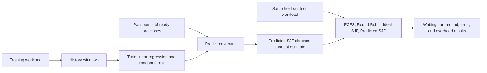

# CPU Burst Prediction for Shortest-Job-First Scheduling

This group project studies whether predicting a process's next CPU burst can help a scheduler choose which ready process should run next. It builds a small Python simulator, trains three burst predictors on generated workloads, and compares predicted Shortest-Job-First (SJF) with First-Come, First-Served (FCFS), Round Robin, and an ideal SJF benchmark. The experiment also records prediction error and the time and memory used by prediction.

The project is a simulation study. It does not change the scheduler in a real operating-system kernel. The supplied experiment uses synthetic workloads so that the team can control how predictable the bursts are and repeat the same trials with fixed random seeds.

## What the group is trying to find out

A CPU burst is one period in which a process uses the CPU before it pauses, often for input/output, or finishes. A process can have several bursts during its lifetime. When a process is ready, the scheduler decides which ready process to run.

SJF can give low average waiting time when the scheduler knows how long each next burst will be. A real operating system does not know the future burst length. This project tests whether an estimate based on previous bursts is useful enough to improve the scheduling decision. It also asks whether that improvement remains useful after the time spent making predictions is counted.

The project follows the research proposal's three questions:

1. **Prediction accuracy:** How accurately do exponential averaging, linear regression, and random forest predict the next CPU burst?
2. **Scheduling effect:** Do predicted-SJF policies improve average waiting time and turnaround time compared with FCFS and Round Robin? How often do they choose a longer burst while a shorter one is waiting?
3. **Predictability and overhead:** How close do predicted-SJF policies come to ideal SJF when bursts become less predictable, and do their results still help when prediction time is charged to the simulation?

The expected result is an experiment that can answer these questions with measurements. No result should be assumed before running the code and examining the output.

The main idea is to keep prediction and scheduling as two separate steps:



## How the experiment works

### 1. Generate separate training and test workloads

The workload generator creates process arrival times and a sequence of CPU bursts for each process. A random seed makes each generated workload repeatable. A noise setting controls how much a burst can change from the previous burst:

- **High predictability** uses low noise, so consecutive bursts tend to be more alike.
- **Medium predictability** allows more change.
- **Low predictability** uses the most noise, so past bursts give less information about the next one.

For every trial and predictability level, the program generates one training workload and a separate test workload. It uses the training bursts to make examples for the machine-learning models. It then evaluates every scheduler on copies of the test workload. Keeping those workloads separate helps prevent the predictors from learning the test answers.

These are controlled synthetic workloads, not measurements from a running Linux machine. The current project scope uses only the synthetic workload generator. The companion research guide explains CPU bursts, the four scheduling approaches, the prediction methods, and why both prediction accuracy and scheduling performance need to be measured.

### 2. Turn burst histories into training examples

With a history window of three, one training example uses three earlier bursts to predict the next burst. For example, the history `[8, 9, 7]` is an input row and `10` is its target. `build_supervised_windows` creates these input and target arrays from the training workload.

At prediction time, the simulator gives the predictor only the process's completed burst history. It does not pass the burst currently being predicted. If a process has fewer observations than a model's three-feature window, the learned models fill the missing earlier positions by repeating the first observed burst. If there is no history yet, they use the configured default estimate.

### 3. Train and use three predictors

- **Exponential averaging** is a traditional estimate. It starts with a configured estimate and updates it after each observed burst. The `alpha` setting controls how much influence the latest burst has. It does not need to learn model parameters from the training set, but it follows the same predictor interface as the other methods.
- **Linear regression** learns a straight-line relationship between the recent burst window and the next burst. It is a simple machine-learning baseline.
- **Random forest regression** combines several small decision trees. It is included as another learned model that can represent less direct relationships between recent bursts and the next one.

Both learned models are trained on the training windows. They use the default estimate until they have been fitted and have enough history to create an input window. Predicted burst lengths are kept positive before they are used to order the ready queue.

For exponential averaging, the update is `new estimate = alpha * latest burst + (1 - alpha) * previous estimate`. For example, with an old estimate of 5 ms, a latest burst of 9 ms, and `alpha = 0.5`, the new estimate is 7 ms.

### 4. Compare scheduling policies

All policies receive a separate copy of the same test workload for a trial:

| Policy | How it selects the next process | Why it is included |
| --- | --- | --- |
| FCFS | Chooses the process that has been ready the longest. | Simple classical baseline. |
| Round Robin | Chooses the front of a queue and runs it for at most the configured time quantum. | Classical time-sharing baseline. |
| Ideal SJF (Oracle) | Chooses the ready process with the shortest true next burst. | Best-case reference; a real scheduler cannot see this future burst. |
| Pred-SJF (ExpAvg) | Chooses the process with the shortest exponential-average prediction. | Traditional burst estimate used with SJF. |
| Pred-SJF (LinearReg) | Chooses the process with the shortest linear-regression prediction. | Learned prediction method. |
| Pred-SJF (RandomForest) | Chooses the process with the shortest random-forest prediction. | Second learned prediction method. |

The simulator is non-preemptive for FCFS and both SJF policies: once one of those processes starts a CPU burst, it runs to the end of that burst. Round Robin is preemptive at the end of each time quantum. The simulator also models a short I/O pause between a process's CPU bursts so that other processes may run in between.

### 5. Measure performance and cost

The program records the following measures for each method and trial:

- **Average waiting time:** average total time per process spent waiting in the ready queue across all of its CPU bursts. For Round Robin, waiting accumulated over all time slices is included.
- **95th-percentile waiting time:** a view of longer waits near the high end of the observed waiting times.
- **Average turnaround time:** time from a process's arrival until its final CPU burst completes. This includes the modeled I/O pauses between its bursts.
- **Mean absolute error (MAE):** average absolute difference between a predicted burst and the true burst, in milliseconds. This only applies to the predicted-SJF methods.
- **Ordering inversion rate:** fraction of scheduling choices that select a process with a longer true burst while a shorter true burst is also ready. The true bursts are used only to score the choice, not by the predicted scheduler to make it.
- **Context switches:** changes from one process ID to another in consecutive CPU selections. The configured switch cost is added to simulated time when this happens.
- **Prediction wall time and CPU time:** time spent making predictions. Wall time is added to simulated time when `charge_overhead` is enabled; CPU time is reported separately.
- **Peak Python memory:** peak memory traced by Python's `tracemalloc` during that simulation. This is not total system or operating-system memory use.

The configured number of fixed-seed trials is run for each of the three predictability levels. The summary table reports mean and standard deviation across trials. The script also prints paired Wilcoxon signed-rank comparisons of average waiting time between each predicted-SJF method and Round Robin. A small p-value is evidence of a difference in these paired trials; it does not by itself explain whether the difference is useful or establish that the same result will hold on real workloads.

## Understanding one small example

Suppose processes A, B, and C all arrive at time zero with one CPU burst each: 8 ms, 3 ms, and 5 ms. With no context-switch cost:

- FCFS in the order A, B, C gives waiting times 0, 8, and 11 ms. The average is 19/3, or about 6.33 ms.
- Ideal SJF orders B, C, A. The waiting times are 0, 3, and 8 ms. The average is 11/3, or about 3.67 ms.
- If the predictions are A=7 ms, B=4 ms, and C=3 ms, predicted SJF orders C, B, A. That is different from ideal SJF because the estimates are not the same as the actual bursts.
- Predicted SJF has to choose using its estimates. If the estimates put the processes in a different order from their true bursts, its waiting-time result can be worse than ideal SJF.

This example shows why ideal SJF is only a reference point: the real question is whether predictions are good enough to make better decisions without using future information.

## Project structure

```text
cpu-burst-prediction-sjf-project/
├── configs/
│   └── experiment.yaml          # Trial counts, workload settings, and model settings
├── src/
│   ├── data/
│   │   ├── generate_workload.py # Repeatable synthetic processes and burst sequences
│   │   └── preprocess.py        # Create history windows for model training
│   ├── models/
│   │   ├── base.py              # Common fit/predict interface
│   │   ├── exponential_averaging.py
│   │   ├── linear_regression.py
│   │   └── random_forest.py
│   ├── scheduling/
│   │   ├── process.py           # State and measurements for one process
│   │   ├── simulator.py         # Event loop and overhead accounting
│   │   ├── fcfs.py
│   │   ├── round_robin.py
│   │   └── sjf.py
│   └── evaluation/
│       ├── metrics.py           # Waiting, turnaround, error, and overhead measures
│       └── overhead.py          # Prediction timing and Python memory tracking
├── tests/                       # Focused checks for scheduling and repeatability
├── results/
│   ├── tables/                  # CSV files written by the experiment
│   └── figures/                 # Plot written by the experiment
├── main.py                      # Experiment entry point
├── requirements.txt
└── requirements-lock.txt
```

Each part has one main responsibility. `main.py` coordinates the work: it reads settings, makes workloads, trains predictors, runs policies, and asks the evaluation helpers to summarize the results. The scheduling modules decide which ready process goes next. The simulator handles time, arrivals, burst completion, Round Robin time slices, and overhead. This makes it easier for group members to read or change one part without putting the whole experiment in a single file.

## Setup and run

Use a supported Python 3 version and run commands from the project root, the folder containing `main.py`.

1. Create and activate a virtual environment:

   ```powershell
   py -m venv .cpu_venv
   .\.cpu_venv\Scripts\Activate.ps1
   ```

2. Install the project packages:

   ```powershell
   python -m pip install -r requirements.txt
   ```

3. Run the experiment:

   ```powershell
   python main.py
   ```

The experiment can take a while because it trains models and runs all policies over repeated workloads. The current settings are in [configs/experiment.yaml](configs/experiment.yaml). For a quick development run, temporarily lower `n_trials`, `n_train_processes`, and `n_test_processes`; restore the intended research settings before generating reportable results.

## Output files

After a successful run, the program creates these files under `results/`:

- `tables/raw_trial_metrics.csv` contains one row for every method, predictability level, and trial.
- `tables/summary_results.csv` contains the mean and standard deviation for each method and predictability level.
- `figures/waiting_time_by_predictability.png` plots average waiting time across the three workload predictability levels. Prediction wall time is included for predicted-SJF runs.

The raw trial table is useful for checking individual runs and carrying out additional analysis. Keep it with the paper tables and figures so that the reported results can be traced back to the experiment.

## Configuration guide

The YAML configuration controls the experiment without needing to edit the Python modules:

- `experiment.n_trials` is the number of repeated trials per predictability level.
- `experiment.base_seed` is the starting random seed. Each trial uses a different seed derived from it.
- `n_train_processes` and `n_test_processes` set workload sizes for fitting and evaluation.
- `bursts_per_process` sets how many CPU bursts are generated for each process.
- `workload.arrival_rate_scale` controls the average spacing between process arrivals.
- `workload.base_burst_mean` controls the average burst length before workload variation is applied.
- `workload.predictability_levels` maps each named condition to its noise level. Larger noise makes the next burst harder to infer from previous bursts.
- `scheduler.time_quantum` sets the maximum CPU time per Round Robin turn.
- `scheduler.context_switch_cost` is added to simulated time when the CPU moves to a different process.
- `scheduler.io_delay` sets the pause between a process's CPU bursts.
- `models.exp_avg_alpha` controls how strongly the exponential estimate reacts to a new burst.
- `models.initial_burst_estimate` is used when there is not yet enough history or training data.
- `models.history_window` is the number of earlier bursts used by the learned predictors.
- `models.rf_n_estimators` and `models.rf_max_depth` set the size and maximum depth of the random forest.

All burst and scheduler times are treated as milliseconds by the experiment. The arrival scale and base burst mean are both expressed in that same unit.

## Limitations to explain in the research report

- The current results come from a simplified simulator, not a real operating-system kernel or live process trace.
- The synthetic workload generator is controlled by a small number of assumptions. Results may change on workloads with different arrival patterns or burst distributions.
- The I/O delay between bursts is fixed, so it does not model different I/O behaviour for different processes.
- Ideal SJF is an oracle baseline with access to true burst lengths; it is not an implementable policy.
- The memory measure is Python allocation tracking, not total process memory, and the CPU timing is limited to predictor calls.
- Training and testing use separately generated workloads from the same workload generator. This checks generalisation to new generated processes, but not to a different generator or a real trace.
- A paired statistical test describes the trial results produced by this setup. It does not remove the need to report effect sizes, variability, design assumptions, and limitations.

These are appropriate boundaries for a student simulator project. State them plainly rather than describing the experiment as a deployed operating-system scheduler.

## Notes for the group manuscript

The course template expects an IMRaD-style research manuscript. This repository mainly supports the method, experimental setup, results, analysis, and reproducibility sections. The group still needs to write and verify the literature review, references, contributions, discussion, threats to validity, declarations, and any publication claims. Do not invent results: run the final configuration, inspect the CSV output, and use those measured values in the abstract and paper.

For the final report, explain which data was generated, how the train/test split was made, the software and hardware environment, seeds, number of trials, baseline policies, prediction models, metrics, and overhead accounting. Include means and standard deviations, discuss why methods differ, report limitations, and make the exact run command available. Verify all cited papers and dataset licences. If AI tools assisted with code or writing, follow the course guide and disclose that assistance as required by the lecturer or venue.
